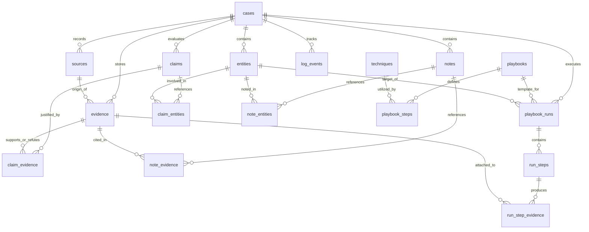
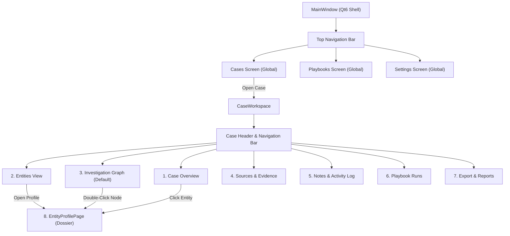
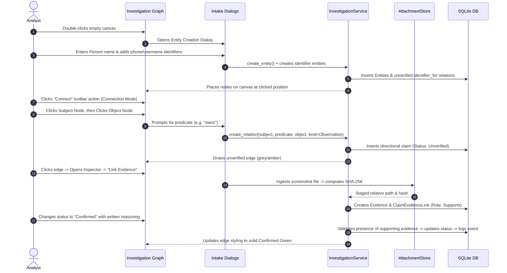
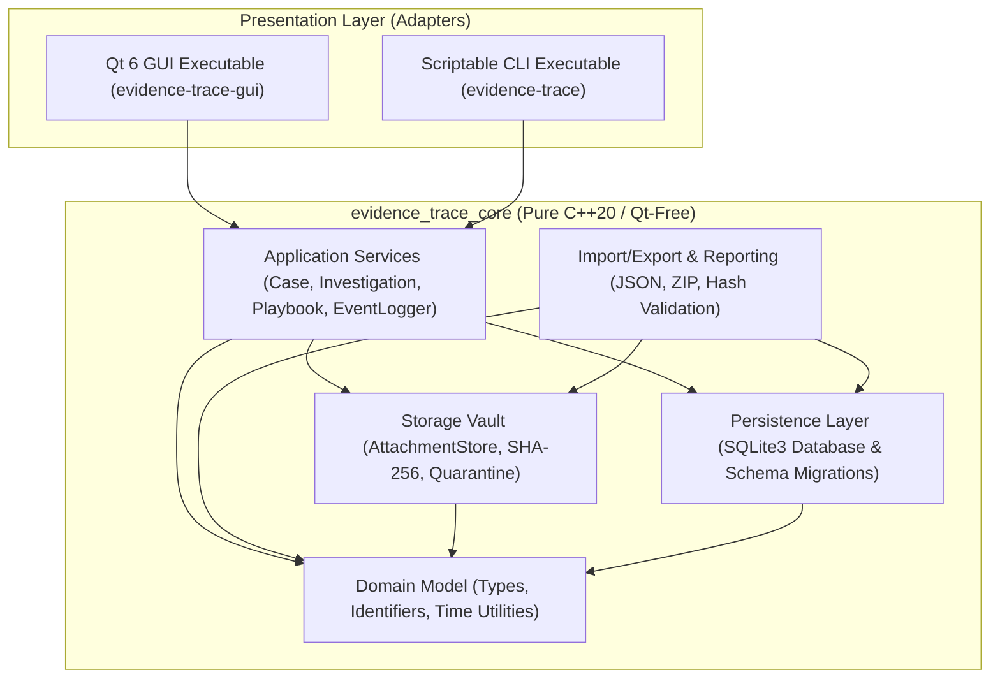

# Evidence Trace — Master Specification (MSP)

| Attribute | Details |
|---|---|
| **Document Identifier** | `MSP-ET-01` |
| **Document Version** | `1.0.0` |
| **Document Status** | Approved — Authoritative Baseline |
| **Release Target** | Baseline v0.1.0 / Current Architecture v0.4.x (Schema v4) |
| **Canonical Product Language** | English (`en-US`) |
| **Localization Status** | Ukrainian (`uk-UA`) deferred; reference draft frozen |
| **Authority & Governance** | Canonical project specification per [`docs/policy/project_documentation_policy.md`](../docs/policy/project_documentation_policy.md) |
| **Primary Codebase References** | [`src/`](../src/), [`tests/integration_tests.cpp`](../tests/integration_tests.cpp), [`CMakeLists.txt`](../CMakeLists.txt) |

---

## 1. Project Overview

### 1.1. Purpose and Mission
**Evidence Trace** is an offline, local-first Open Source Intelligence (OSINT) investigation workbench designed for investigative analysts, researchers, journalists, and forensic examiners. 

Investigations frequently span weeks or months across hundreds of disparate indicators: domain registrations, corporate filings, social accounts, network infrastructure, and multimedia captures. Traditional general-purpose note-taking applications (e.g., Obsidian, Notion) or automated intelligence platforms fail to address the core epistemic problem of OSINT: **preserving verifiable evidentiary provenance** while preventing cognitive bias and premature conclusions.

The core mission of Evidence Trace is to enable an investigator to resume an inquiry months later and unambiguously reconstruct:
1. **What was established** (explicit claims, facts, and hypotheses).
2. **What supports or contradicts it** (preserved files, text excerpts, cryptographic hashes, and source records).
3. **How it was discovered** (repeatable methodology, search queries, and immutable chronological activity logs).

### 1.2. Target Users and Environment
* **Primary User Persona:** A single investigative analyst operating locally on their workstation.
* **Operating Environment:** Linux desktop environment (X11 or Wayland), running natively with Qt 6 Widgets and local SQLite persistence.
* **Network Posture:** Strict offline local isolation. The application makes **zero background network calls**, runs **no telemetry**, and does not communicate with any cloud synchronization server. All case data, attachments, and configuration remain exclusively on the user's local disk.

### 1.3. Core Problems Solved
* **Uncertainty and Assessment Integrity:** In OSINT, an indicator (such as a username or domain) may demonstrably exist, while its connection to an individual remains merely a hypothesis. Evidence Trace enforces a strict conceptual invariant: **confidence and assessment status belong exclusively to a Claim or Relationship, never to an Entity or a Source**.
* **Evidence Degradation and Tampering:** Web sources disappear, profiles are deleted, and online evidence is modified. Evidence Trace copies evidence files into a managed local storage vault, generates SHA-256 cryptographic hashes upon import, and provides verification tooling to detect byte modification or data loss.
* **Methodological Auditability:** Investigative steps are documented using reusable playbook templates and run snapshots. If a methodology template is updated in the future, past case execution logs remain frozen in time.
* **Cognitive Workspace Integration:** Investigators need to explore multi-entity relationship graphs directly, formulate directional relationships with explicit predicates, and inspect conflicting evidence without navigating away from the workspace.

### 1.4. Explicit Scope and Non-Goals
To preserve data integrity, user security, and operational clarity, Evidence Trace explicitly defines the boundaries of the application:

* **Explicitly In Scope (Current Baseline):**
  * Local multi-case container lifecycle (create, edit, archive, restore, permanent cascaded delete).
  * 14 distinct entity types with aliases, arbitrary JSON attributes, and managed illustrative image attachments.
  * Specialized Person identity management with automated multi-identifier extraction (`identifier_for` directional relations).
  * Sources and preserved evidence items (local binary files, quoted text excerpts with location, external URLs).
  * SHA-256 cryptographic hashing and on-demand file integrity verification.
  * Directional relationships (Subject $\xrightarrow{\text{predicate}}$ Object) and multi-entity claims with `observation` or `inference` classifications.
  * Five-level claim assessment statuses (`unverified`, `possible`, `probable`, `confirmed`, `refuted`) with mandatory written reasoning for inferences and mandatory supporting evidence before confirmation.
  * Interactive Investigation Graph workspace with visual two-click connection mode, node positioning, persistent layout zoom/pan state, and context menus for relation editing and direction reversal.
  * Reusable global techniques, playbooks, and immutable case-scoped playbook run snapshots.
  * Chronological activity logging and manual investigation notes with entity/evidence linkages.
  * Cross-case and case-scoped search (`Ctrl+K`).
  * Portable ZIP case export with SHA-256 manifest validation and collision-safe import (Skip or Import as Copy).
  * Standalone Markdown case investigation reports.
  * Comprehensive companion Command-Line Interface (`evidence-trace`).

* **Explicit Non-Goals (Out of Scope / Planned Extensions):**
  * **Automated Identity Determination:** The software does not automatically decide who a person is or present automated matches as verified truth.
  * **Automated Web Scraping or Scanning:** The software does not crawl websites, execute remote port scans, or query external OSINT APIs in the background.
  * **Geospatial GIS Tile Mapping:** The software does **not** contain a geographic/GIS map engine (OpenStreetMap, Leaflet, Marble, or GIS coordinates). "Map" in Evidence Trace refers exclusively to the entity relationship graph.
  * **Application-Level Cryptographic Encryption:** The database and attachments are stored unencrypted in the user's data directory. Confidentiality relies on host Operating System Full-Disk Encryption (LUKS/FDE) and Unix file permissions.
  * **Multi-User Collaboration and Cloud Synchronization:** Evidence Trace is architecturally designed as a single-user local application. Concurrent multi-user access to a single SQLite database is not supported.
  * **Attachment Full-Text Indexing:** The search engine queries SQLite metadata and notes; it does not perform optical character recognition (OCR) on images or extract full text from PDF attachments.

---

## 2. Functional Requirements

Requirements are assigned unique, referenceable identifiers categorized by functional area. Status is strictly classified as `Implemented` or `Planned`.

### 2.1. Investigation and Case Management (`FR-CASE`)

| Requirement ID | Description | Status | Code / Architecture Reference |
|---|---|---|---|
| **`FR-CASE-01`** | **Case Container Creation:** The system shall create an investigation case requiring only a unique `title`. Optional fields include `purpose`, `description`, `primary_target_type` (controlled vocabulary: `person`, `company`, `place`, `domain`, `username`, `event`, `other`), `scope`, and `tags` (string list). | `Implemented` | [`src/services/case_service.cpp`](../src/services/case_service.cpp), [`src/gui/dialogs.cpp`](../src/gui/dialogs.cpp) |
| **`FR-CASE-02`** | **Case Inventory & Metadata Tracking:** The system shall list all cases showing title, status (`active`/`archived`), UTC last-modified time, total entity count, and total claim count. Searching by title and filtering by status/tags shall be supported. | `Implemented` | [`src/services/case_service.cpp`](../src/services/case_service.cpp), [`src/gui/global_pages.cpp`](../src/gui/global_pages.cpp) |
| **`FR-CASE-03`** | **Lifecycle & Immutability:** Editing case metadata must not mutate historical records. Archived cases shall remain readable but visually designated as archived. Unarchiving (restoring) is an explicit action. | `Implemented` | [`src/services/case_service.cpp`](../src/services/case_service.cpp), [`tests/integration_tests.cpp`](../tests/integration_tests.cpp) |
| **`FR-CASE-04`** | **Strict Boundary Isolation:** Every entity, source, evidence, claim, note, and run record belongs to exactly one case. Cross-case data leakage is prevented at the database and service layers. Moving records between cases is outside the MVP. | `Implemented` | [`src/database/migrations.cpp`](../src/database/migrations.cpp), [`src/services/investigation_service.cpp`](../src/services/investigation_service.cpp) |
| **`FR-CASE-05`** | **Cascaded Permanent Deletion:** The system shall provide an explicit, confirmed permanent case deletion action. Deletion must remove all associated records from the SQLite database and safely delete all stored attachment files from the filesystem via staged deletion rollback protection. | `Implemented` | [`src/services/case_service.cpp`](../src/services/case_service.cpp), [`src/storage/attachment_store.cpp`](../src/storage/attachment_store.cpp) |

### 2.2. Entity Management & Dossiers (`FR-ENT`)

| Requirement ID | Description | Status | Code / Architecture Reference |
|---|---|---|---|
| **`FR-ENT-01`** | **Controlled Entity Types:** The system shall support 14 typed entities: `Person`, `Username`, `Account`, `Email`, `Phone`, `Domain`, `Ip`, `Company`, `Place`, `Url`, `Image`, `Document`, `Event`, `Other`. Creation requires a type and label. | `Implemented` | [`src/domain/types.hpp`](../src/domain/types.hpp), [`src/services/investigation_service.cpp`](../src/services/investigation_service.cpp) |
| **`FR-ENT-02`** | **Normalization Without Automatic Merging:** Domain names are normalized to lowercase ASCII; email addresses are converted for lookup while preserving original user input; URLs preserve original query parameters. Normalization shall warn about duplicates within a case but **never** automatically merge records. | `Implemented` | [`src/services/investigation_service.cpp`](../src/services/investigation_service.cpp) |
| **`FR-ENT-03`** | **Multi-Identifier Person Intake:** Creating a `Person` entity supports entering multiple phone numbers, email addresses, usernames, and custom identifiers in a single workflow. Each identifier is stored as an independent typed entity and linked to the Person by an unverified `identifier_for` directional observation. | `Implemented` | [`src/gui/dialogs.cpp`](../src/gui/dialogs.cpp), [`src/gui/investigation_pages.cpp`](../src/gui/investigation_pages.cpp) |
| **`FR-ENT-04`** | **Managed Descriptive Media:** Entities can store one or more managed image attachments (e.g., avatar, document scan, mugshot) copied into the attachment vault. Pasting images directly from the OS clipboard (`Ctrl+V`) into the entity form is supported. Entity images are descriptive attributes, not claims or verified facts. | `Implemented` | [`src/services/investigation_service.cpp`](../src/services/investigation_service.cpp), [`src/gui/dialogs.cpp`](../src/gui/dialogs.cpp) |
| **`FR-ENT-05`** | **Referential Integrity on Entity Deletion:** An entity referenced by active claims cannot be deleted; the UI and API must explicitly reject deletion and identify blocking references. Deleting an unreferenced entity cleanly unlinks note associations without deleting the notes themselves. | `Implemented` | [`src/services/investigation_service.cpp`](../src/services/investigation_service.cpp), [`tests/integration_tests.cpp`](../tests/integration_tests.cpp) |
| **`FR-ENT-06`** | **Comprehensive Entity Dossier:** The system provides an `EntityProfilePage` displaying a summary hero card, duplicate warnings, related claims, directional relations, evidence attachments, image gallery, and associated activity notes. | `Implemented` | [`src/gui/entity_profile_page.cpp`](../src/gui/entity_profile_page.cpp) |
| **`FR-ENT-07`** | **Batch Entity Import:** Automated bulk intake of entities from CSV or JSON files. | `Planned` | Documented in roadmap; not implemented in codebase. |

### 2.3. Sources and Preserved Evidence (`FR-EVD`)

| Requirement ID | Description | Status | Code / Architecture Reference |
|---|---|---|---|
| **`FR-EVD-01`** | **Source Record Tracking:** Sources store provenance details: `type` (`web`, `document`, `registry`, `person`, `other`), `locator` (e.g. URL or registry ID), `title`, `accessed_at` (UTC ISO-8601), `author`, and `reliability_note`. A source is distinct from the evidence preserved from it. | `Implemented` | [`src/domain/types.hpp`](../src/domain/types.hpp), [`src/services/investigation_service.cpp`](../src/services/investigation_service.cpp) |
| **`FR-EVD-02`** | **Multi-Kind Evidence Ingestion:** The system supports three evidence kinds: (1) `File` (local file or screenshot copied into storage, SHA-256 hashed, immutable), (2) `Text` (verbatim excerpt with optional `quotation_location`), (3) `Url` (unpreserved external bookmark flagged as `external only`). | `Implemented` | [`src/storage/attachment_store.cpp`](../src/storage/attachment_store.cpp), [`src/services/investigation_service.cpp`](../src/services/investigation_service.cpp) |
| **`FR-EVD-03`** | **Integrity Verification:** On demand, the system recalculates the SHA-256 hash of a preserved file and compares it to the stored hash. Discrepancies or missing files are reported without automatically altering claim statuses. | `Implemented` | [`src/storage/attachment_store.cpp`](../src/storage/attachment_store.cpp), [`tests/integration_tests.cpp`](../tests/integration_tests.cpp) |
| **`FR-EVD-04`** | **Safe In-App Previews:** The desktop UI renders read-only text previews and raster images (`PNG`, `JPEG`) securely within Qt widgets. Preserved binary files are never executed or passed to shell handlers. | `Implemented` | [`src/gui/investigation_pages.cpp`](../src/gui/investigation_pages.cpp) |
| **`FR-EVD-05`** | **Many-to-Many Evidence Association:** One evidence item can link to multiple claims and multiple playbook run steps. Unlinking evidence from a claim leaves the file and metadata intact. | `Implemented` | [`src/services/investigation_service.cpp`](../src/services/investigation_service.cpp), [`tests/integration_tests.cpp`](../tests/integration_tests.cpp) |
| **`FR-EVD-06`** | **Automated Web Page Archiving:** Automated local HTML/MHTML snapshotting or headless browser capture upon URL entry. | `Planned` | Roadmap item; requires external browser engine. |

### 2.4. Claims and Directional Relationships (`FR-CLM`)

| Requirement ID | Description | Status | Code / Architecture Reference |
|---|---|---|---|
| **`FR-CLM-01`** | **Claim Record Structure:** A claim contains a `statement`, classification `kind` (`observation` or `inference`), assessment `status`, written `reasoning`, `recorded_by`, and UTC timestamps. Inferences strictly require written reasoning. | `Implemented` | [`src/domain/types.hpp`](../src/domain/types.hpp), [`src/database/migrations.cpp`](../src/database/migrations.cpp) |
| **`FR-CLM-02`** | **Assessment Status Scale:** The system supports 5 explicit statuses: `unverified`, `possible`, `probable`, `confirmed`, `refuted`. Status changes require an explanatory note and log previous and new states in the activity history. Refuted claims remain in the database and reports. | `Implemented` | [`src/services/investigation_service.cpp`](../src/services/investigation_service.cpp), [`src/import_export/import_export_service.cpp`](../src/import_export/import_export_service.cpp) |
| **`FR-CLM-03`** | **Confirmation Safeguard:** Setting a claim or relation status to `confirmed` requires at least one supporting evidence link (`EvidenceRole::Supports`) and non-empty written reasoning. Unlinking evidence later does not automatically downgrade the status, but logs the change. | `Implemented` | [`src/services/investigation_service.cpp`](../src/services/investigation_service.cpp), [`tests/integration_tests.cpp`](../tests/integration_tests.cpp) |
| **`FR-CLM-04`** | **Directional Binary Relationships:** A relation is a specialized claim connecting two entities with a typed `predicate` (e.g., `owns`, `belongs_to`, `works_for`, `registered_to`). The link assigns `Subject` and `Object` roles; direction is strictly preserved and significant. | `Implemented` | [`src/services/investigation_service.cpp`](../src/services/investigation_service.cpp), [`src/gui/investigation_pages.cpp`](../src/gui/investigation_pages.cpp) |
| **`FR-CLM-05`** | **Predicate Editing & Direction Reversal:** The system allows editing the relation predicate or reversing relationship direction ($\text{Subject} \leftrightarrow \text{Object}$) in-place while preserving evidence links, status, and history. | `Implemented` | [`src/services/investigation_service.cpp`](../src/services/investigation_service.cpp), [`tests/integration_tests.cpp`](../tests/integration_tests.cpp) |
| **`FR-CLM-06`** | **Evidence Roles:** Evidence attached to claims is qualified by role: `supports`, `contradicts`, or `context`, accompanied by an optional note. Contradictory evidence remains linked when a claim is marked refuted. | `Implemented` | [`src/domain/types.hpp`](../src/domain/types.hpp), [`src/services/investigation_service.cpp`](../src/services/investigation_service.cpp) |

### 2.5. Investigation Graph Workspace (`FR-GRP`)

| Requirement ID | Description | Status | Code / Architecture Reference |
|---|---|---|---|
| **`FR-GRP-01`** | **Primary Workspace Surface:** The Investigation Graph is the default tab displayed when opening a case. It renders all case entities (including isolated nodes) and directional relationship edges. | `Implemented` | [`src/gui/main_window.cpp`](../src/gui/main_window.cpp), [`src/gui/investigation_pages.cpp`](../src/gui/investigation_pages.cpp) |
| **`FR-GRP-02`** | **Direct Canvas Creation:** Double-clicking the canvas or clicking the toolbar action creates an entity directly at the requested canvas coordinates without leaving the graph. | `Implemented` | [`src/gui/investigation_pages.cpp`](../src/gui/investigation_pages.cpp) |
| **`FR-GRP-03`** | **Visual Two-Click Connection Mode:** Users can click "Connect" or use a node's context menu, then select a target entity to establish a relationship. A dashed preview line follows the cursor; pressing `Esc` or clicking empty space cancels. A lightweight dialog prompts for the predicate. | `Implemented` | [`src/gui/investigation_pages.cpp`](../src/gui/investigation_pages.cpp) |
| **`FR-GRP-04`** | **Persistent Layout and View State:** Per-case node positions $(X, Y)$, zoom factor, and canvas center coordinates persist locally across application launches in `QSettings`. | `Implemented` | [`src/gui/investigation_pages.cpp`](../src/gui/investigation_pages.cpp) |
| **`FR-GRP-05`** | **Interactive Inspection & Styling:** Edge colors reflect claim assessment statuses (`confirmed` = green, `refuted` = red, `possible`/`probable` = amber/blue). Clicking an edge opens its inspector; right-clicking provides edit, reverse, and delete actions. | `Implemented` | [`src/gui/investigation_pages.cpp`](../src/gui/investigation_pages.cpp), [`src/gui/gui_helpers.cpp`](../src/gui/gui_helpers.cpp) |
| **`FR-GRP-06`** | **Automated Force-Directed Layout:** Algorithmic auto-clustering and force-directed node positioning for large graphs. | `Planned` | Manual dragging and grid/quadrant layouts currently implemented. |

### 2.6. Maps & Geospatial Features (`FR-GEO`)

| Requirement ID | Description | Status | Code / Architecture Reference |
|---|---|---|---|
| **`FR-GEO-01`** | **Relationship Graph Mapping:** Interactive node-edge visualization of entity relations (the "Relationship Map"). | `Implemented` | Implemented in `ClaimsPage` as the visual graph workspace. |
| **`FR-GEO-02`** | **Geographic / GIS Map Engine:** Interactive map tiles (OpenStreetMap/satellite), latitude/longitude coordinate plotting, GPS track import, or shapefile overlays. | `Unimplemented / Planned` | **Not implemented.** Evidence Trace does not contain a GIS map engine. Entities of type `Place` store text descriptions only. |

### 2.7. Playbooks and Methodology (`FR-PLY`)

| Requirement ID | Description | Status | Code / Architecture Reference |
|---|---|---|---|
| **`FR-PLY-01`** | **Global Reusable Techniques:** Maintain catalog of techniques with name, objective, instructions, sample queries, tool links, limitations, and tags. Seeded with "Check commit history". | `Implemented` | [`src/database/migrations.cpp`](../src/database/migrations.cpp), [`src/services/playbook_service.cpp`](../src/services/playbook_service.cpp) |
| **`FR-PLY-02`** | **Global Playbook Templates:** Ordered checklists of techniques. Seeded with "Username investigation". | `Implemented` | [`src/services/playbook_service.cpp`](../src/services/playbook_service.cpp) |
| **`FR-PLY-03`** | **Immutable Case Run Snapshots:** Starting a playbook run within a case deep-copies technique instructions and names into `run_steps`. Modifying global templates later **never** alters historical run records. | `Implemented` | [`src/services/playbook_service.cpp`](../src/services/playbook_service.cpp), [`tests/integration_tests.cpp`](../tests/integration_tests.cpp) |
| **`FR-PLY-04`** | **Step Execution Tracking:** Run steps support state (`todo`, `done`, `skipped`), completion timestamps, execution notes, and direct links to resulting evidence items. | `Implemented` | [`src/services/playbook_service.cpp`](../src/services/playbook_service.cpp) |

### 2.8. Activity Logs, Notes, and Search (`FR-LOG`)

| Requirement ID | Description | Status | Code / Architecture Reference |
|---|---|---|---|
| **`FR-LOG-01`** | **Automated Case Event Logging:** All structural actions (creations, edits, deletions, status changes, integrity checks, import/export) generate immutable UTC-timestamped event records in `log_events`. | `Implemented` | [`src/services/event_logger.cpp`](../src/services/event_logger.cpp) |
| **`FR-LOG-02`** | **Manual Investigation Notes:** Investigators can create arbitrary notes recording thoughts, queries, and failed leads, optionally linking one entity and one evidence item. | `Implemented` | [`src/services/investigation_service.cpp`](../src/services/investigation_service.cpp) |
| **`FR-LOG-03`** | **Case-Scoped Search:** Case search queries titles, statements, URLs, notes, and filenames using SQL pattern matching. | `Implemented` | [`src/services/investigation_service.cpp`](../src/services/investigation_service.cpp) |
| **`FR-LOG-04`** | **Global Cross-Case Search (`Ctrl+K`):** Global top-bar search allows instant lookup across all cases and navigates directly to the target record context. | `Implemented` | [`src/gui/main_window.cpp`](../src/gui/main_window.cpp) |
| **`FR-LOG-05`** | **Search Date and Type Filters:** Filtering search results specifically by date range and record type in the service layer. | `Planned` | Service API currently matches text fields; UI provides local table filters. |

### 2.9. Portability, Import, and Export (`FR-EXP`)

| Requirement ID | Description | Status | Code / Architecture Reference |
|---|---|---|---|
| **`FR-EXP-01`** | **ZIP Case Archive Export:** Exports a portable `.zip` bundle containing `case.json` (all entities, claims, sources, evidence, notes, runs, and events), `manifest.json` (file paths, sizes, SHA-256 hashes), and the `attachments/` folder. | `Implemented` | [`src/import_export/import_export_service.cpp`](../src/import_export/import_export_service.cpp) |
| **`FR-EXP-02`** | **Pre-Import Archive Validation:** Validates schema version, archive structure, file sizes (max 100 MiB/entry, 1 GiB total), SHA-256 hashes, and rejects unsafe paths (`../`, absolute paths, symlinks). Any error aborts import before database insertion. | `Implemented` | [`src/import_export/import_export_service.cpp`](../src/import_export/import_export_service.cpp), [`tests/integration_tests.cpp`](../tests/integration_tests.cpp) |
| **`FR-EXP-03`** | **Collision Handling (Skip / Copy):** If importing an archive whose case ID exists: `SkipExisting` leaves the local case untouched; `ImportAsCopy` generates new UUIDs for the case and all internal references, creating an independent clone. | `Implemented` | [`src/import_export/import_export_service.cpp`](../src/import_export/import_export_service.cpp) |
| **`FR-EXP-04`** | **Standalone Markdown Investigation Report:** Generates a clean Markdown summary separating confirmed conclusions from refuted and unverified hypotheses, detailing evidence citations, hashes, and chronology. | `Implemented` | [`src/import_export/import_export_service.cpp`](../src/import_export/import_export_service.cpp) |
| **`FR-EXP-05`** | **PDF Report Generation:** Native PDF document compilation with embedded charts and images. | `Planned` | External formatting tooling required; Markdown currently standard. |

---

## 3. Data Model & Storage Architecture

### 3.1. Entity-Relationship Model
The SQLite schema enforces referential integrity through foreign keys (`PRAGMA foreign_keys = ON`) with `ON DELETE RESTRICT` on data records to prevent silent data loss.



### 3.2. Current Implemented Database Schema (Version 4)
The database structure is defined across four sequential migrations in [`src/database/migrations.cpp`](../src/database/migrations.cpp):

```sql
-- Migration 1: Core Foundation
CREATE TABLE cases (
    id TEXT PRIMARY KEY NOT NULL,
    title TEXT NOT NULL CHECK(length(trim(title)) > 0),
    purpose TEXT NOT NULL DEFAULT '',
    description TEXT NOT NULL DEFAULT '',
    primary_target_type TEXT,
    scope TEXT NOT NULL DEFAULT '',
    tags_json TEXT NOT NULL DEFAULT '[]',
    status TEXT NOT NULL DEFAULT 'active' CHECK(status IN ('active', 'archived')),
    created_at TEXT NOT NULL,
    updated_at TEXT NOT NULL
);

CREATE TABLE entities (
    id TEXT PRIMARY KEY NOT NULL,
    case_id TEXT NOT NULL REFERENCES cases(id) ON DELETE RESTRICT,
    type TEXT NOT NULL CHECK(type IN ('person','username','account','email','phone','domain','ip','company','place','url','image','document','event','other')),
    label TEXT NOT NULL CHECK(length(trim(label)) > 0),
    original_value TEXT NOT NULL DEFAULT '',
    canonical_value TEXT NOT NULL DEFAULT '',
    details_json TEXT NOT NULL DEFAULT '{}',
    tags_json TEXT NOT NULL DEFAULT '[]',
    created_at TEXT NOT NULL,
    updated_at TEXT NOT NULL
);

CREATE TABLE sources (
    id TEXT PRIMARY KEY NOT NULL,
    case_id TEXT NOT NULL REFERENCES cases(id) ON DELETE RESTRICT,
    type TEXT NOT NULL CHECK(type IN ('web','document','registry','person','other')),
    locator TEXT NOT NULL DEFAULT '',
    title TEXT NOT NULL DEFAULT '',
    accessed_at TEXT NOT NULL,
    author TEXT NOT NULL DEFAULT '',
    reliability_note TEXT NOT NULL DEFAULT '',
    created_at TEXT NOT NULL
);

CREATE TABLE evidence (
    id TEXT PRIMARY KEY NOT NULL,
    case_id TEXT NOT NULL REFERENCES cases(id) ON DELETE RESTRICT,
    source_id TEXT REFERENCES sources(id) ON DELETE RESTRICT,
    kind TEXT NOT NULL CHECK(kind IN ('file','text','url')),
    relative_path TEXT,
    original_filename TEXT,
    mime_type TEXT,
    byte_size INTEGER,
    sha256 TEXT,
    text_content TEXT NOT NULL DEFAULT '',
    source_url TEXT,
    captured_at TEXT NOT NULL,
    imported_at TEXT NOT NULL,
    note TEXT NOT NULL DEFAULT '',
    created_at TEXT NOT NULL,
    CHECK(kind != 'file' OR (relative_path IS NOT NULL AND sha256 IS NOT NULL AND byte_size IS NOT NULL AND byte_size >= 0)),
    CHECK(kind != 'text' OR relative_path IS NULL),
    CHECK(kind != 'url' OR (source_url IS NOT NULL AND relative_path IS NULL))
);

CREATE TABLE claims (
    id TEXT PRIMARY KEY NOT NULL,
    case_id TEXT NOT NULL REFERENCES cases(id) ON DELETE RESTRICT,
    statement TEXT NOT NULL CHECK(length(trim(statement)) > 0),
    kind TEXT NOT NULL CHECK(kind IN ('observation','inference')),
    predicate TEXT,
    status TEXT NOT NULL DEFAULT 'unverified' CHECK(status IN ('unverified','possible','probable','confirmed','refuted')),
    reasoning TEXT NOT NULL DEFAULT '',
    recorded_by TEXT NOT NULL DEFAULT '',
    created_at TEXT NOT NULL,
    updated_at TEXT NOT NULL,
    CHECK(kind != 'inference' OR length(trim(reasoning)) > 0)
);

CREATE TABLE claim_entities (
    claim_id TEXT NOT NULL REFERENCES claims(id) ON DELETE RESTRICT,
    entity_id TEXT NOT NULL REFERENCES entities(id) ON DELETE RESTRICT,
    role TEXT NOT NULL CHECK(role IN ('subject','object','context')),
    PRIMARY KEY(claim_id, entity_id, role)
);

CREATE TABLE claim_evidence (
    claim_id TEXT NOT NULL REFERENCES claims(id) ON DELETE RESTRICT,
    evidence_id TEXT NOT NULL REFERENCES evidence(id) ON DELETE RESTRICT,
    role TEXT NOT NULL CHECK(role IN ('supports','contradicts','context')),
    note TEXT NOT NULL DEFAULT '',
    PRIMARY KEY(claim_id, evidence_id)
);

CREATE TABLE notes (
    id TEXT PRIMARY KEY NOT NULL,
    case_id TEXT NOT NULL REFERENCES cases(id) ON DELETE RESTRICT,
    title TEXT NOT NULL DEFAULT '',
    body TEXT NOT NULL CHECK(length(trim(body)) > 0),
    created_at TEXT NOT NULL,
    updated_at TEXT NOT NULL
);

CREATE TABLE note_entities (
    note_id TEXT NOT NULL REFERENCES notes(id) ON DELETE RESTRICT,
    entity_id TEXT NOT NULL REFERENCES entities(id) ON DELETE RESTRICT,
    PRIMARY KEY(note_id, entity_id)
);

CREATE TABLE note_evidence (
    note_id TEXT NOT NULL REFERENCES notes(id) ON DELETE RESTRICT,
    evidence_id TEXT NOT NULL REFERENCES evidence(id) ON DELETE RESTRICT,
    PRIMARY KEY(note_id, evidence_id)
);

CREATE TABLE techniques (
    id TEXT PRIMARY KEY NOT NULL,
    name TEXT NOT NULL CHECK(length(trim(name)) > 0),
    objective TEXT NOT NULL DEFAULT '',
    steps TEXT NOT NULL DEFAULT '',
    example_queries_json TEXT NOT NULL DEFAULT '[]',
    tools_links_json TEXT NOT NULL DEFAULT '[]',
    limitations TEXT NOT NULL DEFAULT '',
    tags_json TEXT NOT NULL DEFAULT '[]',
    created_at TEXT NOT NULL,
    updated_at TEXT NOT NULL
);

CREATE TABLE playbooks (
    id TEXT PRIMARY KEY NOT NULL,
    name TEXT NOT NULL CHECK(length(trim(name)) > 0),
    scope TEXT NOT NULL DEFAULT '',
    description TEXT NOT NULL DEFAULT '',
    created_at TEXT NOT NULL,
    updated_at TEXT NOT NULL
);

CREATE TABLE playbook_steps (
    id TEXT PRIMARY KEY NOT NULL,
    playbook_id TEXT NOT NULL REFERENCES playbooks(id) ON DELETE RESTRICT,
    technique_id TEXT REFERENCES techniques(id) ON DELETE SET NULL,
    name TEXT NOT NULL CHECK(length(trim(name)) > 0),
    instructions TEXT NOT NULL DEFAULT '',
    position INTEGER NOT NULL CHECK(position >= 0),
    UNIQUE(playbook_id, position)
);

CREATE TABLE playbook_runs (
    id TEXT PRIMARY KEY NOT NULL,
    case_id TEXT NOT NULL REFERENCES cases(id) ON DELETE RESTRICT,
    playbook_id TEXT REFERENCES playbooks(id) ON DELETE SET NULL,
    entity_id TEXT REFERENCES entities(id) ON DELETE RESTRICT,
    name_snapshot TEXT NOT NULL,
    started_at TEXT NOT NULL,
    updated_at TEXT NOT NULL
);

CREATE TABLE run_steps (
    id TEXT PRIMARY KEY NOT NULL,
    run_id TEXT NOT NULL REFERENCES playbook_runs(id) ON DELETE RESTRICT,
    source_step_id TEXT,
    position INTEGER NOT NULL CHECK(position >= 0),
    name_snapshot TEXT NOT NULL,
    instructions_snapshot TEXT NOT NULL DEFAULT '',
    state TEXT NOT NULL DEFAULT 'todo' CHECK(state IN ('todo','done','skipped')),
    completed_at TEXT,
    note TEXT NOT NULL DEFAULT '',
    UNIQUE(run_id, position)
);

CREATE TABLE run_step_evidence (
    run_step_id TEXT NOT NULL REFERENCES run_steps(id) ON DELETE RESTRICT,
    evidence_id TEXT NOT NULL REFERENCES evidence(id) ON DELETE RESTRICT,
    PRIMARY KEY(run_step_id, evidence_id)
);

CREATE TABLE log_events (
    id TEXT PRIMARY KEY NOT NULL,
    case_id TEXT NOT NULL REFERENCES cases(id) ON DELETE RESTRICT,
    occurred_at TEXT NOT NULL,
    action TEXT NOT NULL,
    object_type TEXT NOT NULL,
    object_id TEXT,
    description TEXT NOT NULL,
    payload_json TEXT NOT NULL DEFAULT '{}'
);

-- Migration 2: Evidence Quotation Location
ALTER TABLE evidence ADD COLUMN quotation_location TEXT NOT NULL DEFAULT '';

-- Migration 3: Entity Aliases
ALTER TABLE entities ADD COLUMN aliases_json TEXT NOT NULL DEFAULT '[]';

-- Migration 4: Managed Images
ALTER TABLE entities ADD COLUMN image_paths_json TEXT NOT NULL DEFAULT '[]';
ALTER TABLE evidence ADD COLUMN image_paths_json TEXT NOT NULL DEFAULT '[]';

-- Indexes
CREATE INDEX idx_entities_case ON entities(case_id);
CREATE INDEX idx_entities_canonical ON entities(case_id, type, canonical_value);
CREATE INDEX idx_sources_case_locator ON sources(case_id, locator);
CREATE INDEX idx_evidence_case ON evidence(case_id);
CREATE INDEX idx_claims_case_status ON claims(case_id, status);
CREATE INDEX idx_claims_updated ON claims(updated_at);
CREATE INDEX idx_log_case_time ON log_events(case_id, occurred_at);
CREATE INDEX idx_runs_case ON playbook_runs(case_id);
CREATE INDEX idx_notes_case ON notes(case_id);
```

### 3.3. Attachment File Storage & Staged Deletion Safety
Preserved files and images are managed by `AttachmentStore` ([`src/storage/attachment_store.cpp`](../src/storage/attachment_store.cpp)):
1. **Opaque Storage:** Uploaded files are copied into `<data-dir>/attachments/<uuid>.<ext>` using random UUIDs to avoid filename collisions and path injection.
2. **Atomic Ingestion:** Files are first staged into temporary `.tmp-*` files, hashed via OpenSSL SHA-256, and then moved atomically into `attachments/` upon database transaction commit.
3. **Quarantine & Crash Recovery:** File deletion uses staged removals (`.trash-*`). If a database transaction aborts or fails during deletion, the staged file is restored. On application startup, `recover_staged_removals()` checks SQLite ownership; files still owned by the database are restored, while orphans are discarded.

### 3.4. Planned Future Schema Enhancements
* **Event Time & Precision:** Schema v4 stores record generation/acquisition time (`captured_at`, `imported_at`, `created_at`). Proposed future schema v5 will add separate `event_occurred_at` (when real-world action happened) and `event_time_precision` (`exact`, `day`, `month`, `year`, `unknown`).
* **Full-Text Search (FTS5):** SQLite FTS5 virtual tables to index note bodies, claim statements, and OCR text.

---

## 4. User Interface Architecture and Workflows

### 4.1. Screen Organization & Navigation Structure
The desktop interface is built using Qt 6 Widgets and organized into three top-level screens and eight case-specific workspaces:



#### Screen Responsibilities:
1. **Global Cases (`CasesPage`):** Lists all active/archived cases, search bar, status filters, case metadata inspector, create/edit/archive/delete actions.
2. **Global Playbooks (`PlaybooksPage`):** Catalog management of reusable techniques, playbook step ordering, and template creation.
3. **Global Settings (`SettingsPage`):** 
   * *General:* Displays local case folder path, "Change folder..." action (persisted across restarts), file size boundary (100 MiB), and offline notice.
   * *Appearance:* Accent color picker (Default Indigo, Blue, Teal, Amber, Violet), control density (Comfortable / Compact), text sizing, font selector, case-tab glow toggle, live non-mutating preview.
4. **Case Overview (`CaseOverviewPage`):** Case summary, entity/claim/evidence metrics, quick-action creation buttons, recent activity feed, and unresolved claims list.
5. **Entities View (`EntitiesPage`):** Sortable table of entities, search/type filters, detail inspector, linked claims/evidence lists, and duplicate warnings.
6. **Investigation Graph (`ClaimsPage`):** The primary default workspace. Canvas-based node-link diagram, visual two-click connection tool, edge inspector, and integrated relation table below canvas.
7. **Sources & Evidence (`EvidencePage`):** Dual-tab table view for Sources and Evidence, text/kind/source filters, preview pane, SHA-256 verification button, and image attachment management.
8. **Notes & Log (`NotesPage`):** Chronological activity feed and markdown note editor with entity/evidence attachment selectors.
9. **Playbook Runs (`RunsPage`):** Active case checklists, step execution tracking, note taking, and run-evidence association.
10. **Export & Portability (`ExportPage`):** One-click ZIP case archive generation and standalone Markdown report exporter.
11. **Entity Profile Dossier (`EntityProfilePage`):** In-depth entity dossier featuring a hero identity card, quick attribute chips, and 6 specialized sub-tabs: *Overview & Background*, *Relations*, *Claims*, *Evidence*, *Gallery*, and *Notes & Activity*.

### 4.2. Primary User Workflows

#### Workflow A: From Discovered Indicator to Verified Assessment


#### Workflow B: Playbook Execution and Snapshot Isolation
1. Analyst starts a run of "Username investigation" within Case A.
2. `PlaybookService` creates `playbook_runs` and copies all step instructions into `run_steps`.
3. Analyst completes Step 1 ("Search commit history"), marks it `Done`, writes a note, and links preserved evidence.
4. Later, another user updates the global "Username investigation" playbook template.
5. Case A's run steps remain **completely unchanged**, ensuring historical repeatability.

---

## 5. Architecture & Technical Design

### 5.1. Technology Stack & Dependencies
* **Programming Language:** Modern C++20 (`-std=c++20`, strict pedantic warnings `-Wall -Wextra -Wpedantic`).
* **Build System:** CMake 3.20+ with out-of-source builds (`build/`).
* **Core Application Libraries:**
  * **Database:** SQLite 3 (`libsqlite3-dev`) via custom RAII wrapper classes ([`src/database/sqlite_database.hpp`](../src/database/sqlite_database.hpp)).
  * **Cryptography:** OpenSSL Crypto (`libssl-dev`) for streaming SHA-256 calculation.
  * **Archiving:** `libzip` (`libzip-dev`) for portable case archive import/export.
* **User Interface:** Qt 6 (`qt6-base-dev`): `Qt6::Core`, `Qt6::Gui`, `Qt6::Widgets`.
* **Platform:** Linux desktop (Ubuntu 22.04+, Debian 12+, Arch, Fedora).

### 5.2. Project Directory Structure
```text
Evidence_Osint_tool/
├── CMakeLists.txt                # Root build definition & target specifications
├── install.sh                    # Linux installation and build orchestration script
├── packaging/                    # Linux desktop launcher (.desktop) and metadata
├── src/
│   ├── domain/                   # Core business types, enums, opaque UUID/time helpers
│   │   ├── types.hpp / .cpp
│   ├── database/                 # SQLite connection wrappers, migrations, RAII statements
│   │   ├── sqlite_database.hpp / .cpp
│   │   ├── migrations.hpp / .cpp
│   ├── storage/                  # AttachmentStore, SHA-256 hashing, quarantine recovery
│   │   ├── attachment_store.hpp / .cpp
│   ├── services/                 # Backend business logic (Qt-independent)
│   │   ├── case_service.hpp / .cpp
│   │   ├── investigation_service.hpp / .cpp
│   │   ├── playbook_service.hpp / .cpp
│   │   ├── event_logger.hpp / .cpp
│   ├── import_export/            # JSON parser, ZIP archive validation, Markdown report
│   │   ├── json.hpp / .cpp
│   │   ├── import_export_service.hpp / .cpp
│   ├── cli/                      # Scriptable CLI application entry point
│   │   └── main.cpp
│   └── gui/                      # Qt 6 Desktop application
│       ├── main.cpp              # GUI entry point & headless smoke test options
│       ├── application_context.hpp / .cpp # Context lifecycle & service locator
│       ├── main_window.hpp / .cpp# Shell window, top bar, & CaseWorkspace manager
│       ├── global_pages.hpp / .cpp # Cases, Playbooks, Settings pages
│       ├── investigation_pages.hpp / .cpp # Overview, Entities, Claims/Graph, Evidence
│       ├── entity_profile_page.hpp / .cpp # Dedicated multi-tab entity dossier
│       ├── context_pages.hpp / .cpp # Notes/Log, Runs, Export screens
│       ├── dialogs.hpp / .cpp    # Validated input modal dialogs
│       └── gui_helpers.hpp / .cpp# Visual theme, icons, table styling, chips
├── tests/
│   └── integration_tests.cpp     # Comprehensive automated end-to-end integration tests
└── docs/                         # Governed project documentation
    ├── spec/                     # Canonical specifications (master-spec.md)
    ├── internal_spec/            # Subsystem technical notes & behavior specs
    ├── policy/                   # Project documentation policies
    └── user/                     # End-user guides (GUI, CLI)
```

### 5.3. Component Layering and Separation of Concerns
The application enforces a strict boundary between core business logic and presentation adapters:



* **Core Backend (`evidence_trace_core`):** Fully isolated from Qt. All business constraints (confirmation requirements, duplicate warnings, referential integrity, ZIP validation) are enforced in `evidence_trace_core`.
* **Adapters (`GUI` and `CLI`):** Pure consumer adapters. Widgets never execute direct SQL queries. New features must be implemented in application services first before being exposed in UI or CLI.

---

## 6. Security, Privacy, and Data Integrity

### 6.1. Authentic Authentication & Authorization
* **Single-User Local Desktop Application:** Evidence Trace has **no user accounts, passwords, roles, or multi-tenant authorization**. Access control is governed entirely by OS filesystem user permissions.
* **Zero Telemetry / Offline Guarantee:** The codebase contains no network sockets, HTTP clients, or telemetry hooks. Stored data is never transmitted across the network.

### 6.2. Data Protection at Rest
* **Application-Level Encryption:** `Unimplemented`. The SQLite database file (`evidence_trace.sqlite3`) and attachment files are stored as unencrypted plaintext/binary on the filesystem.
* **Protection Recommendation:** Users handling sensitive intelligence material must rely on host Operating System Full-Disk Encryption (LUKS, BitLocker, or FileVault) and secure filesystem permissions (`chmod 700`).

### 6.3. File Handling, Sanitization, and Traversal Defense
* **Attachment Opaque Isolation:** Preserved files are stored using internally generated UUIDs (`attachments/<uuid>.<ext>`), preventing directory traversal (`../../`) attacks through user-controlled filenames.
* **ZIP Import Boundary Validation:** When importing case archives, `ImportExportService` strictly validates:
  1. No entry path contains `../` or resolves to an absolute path.
  2. No symbolic links or device nodes exist in the archive.
  3. Every entry size is under 100 MiB; total uncompressed archive size is under 1 GiB; entry count is under 10,000.
  4. Every file's SHA-256 hash matches `manifest.json` exactly prior to database record creation.
* **Non-Execution Invariant:** The desktop UI never invokes external shells or executes preserved evidence files. Previews are limited to standard Qt text viewers and raster image decoders.

### 6.4. Cryptographic Integrity vs. Provenance Limits
* **SHA-256 Hashing:** Used to detect file bitrot or tampering *relative to the stored baseline*. A hash verification match proves that the file on disk matches the byte-stream imported earlier.
* **Cryptographic Limits:** SHA-256 does **not** prove that the content was authentic or unaltered at the time the author originally published it online. Chain-of-custody for legal proceedings requires external qualified timestamps and procedural controls.

---

## 7. Requirements Traceability and Acceptance Criteria

The system's core capabilities are verified through automated integration testing in [`tests/integration_tests.cpp`](../tests/integration_tests.cpp).

### 7.1. Acceptance Criteria Mapping

| ID | Verified Functional Behavior | Test Implementation in `tests/integration_tests.cpp` | Test Result |
|---|---|---|---|
| **`AC-01`** | Case metadata, tags, and state persist across database reopen. | Lines 142–165 | **PASS** |
| **`AC-02`** | Directional relation appears on subject and object entity queries. | Lines 194–198 | **PASS** |
| **`AC-03`** | Changing status to `Confirmed` without supporting evidence is rejected. | Lines 198–199 | **PASS** |
| **`AC-04`** | Modifying external original file leaves preserved copy and hash intact. | Lines 177–186 | **PASS** |
| **`AC-05`** | Corrupting preserved attachment bytes triggers integrity failure without altering claim status. | Lines 186–188, 206–209 | **PASS** |
| **`AC-06`** | Removing one evidence-claim link leaves the evidence accessible to second claim. | Lines 200–205 | **PASS** |
| **`AC-07`** | Status change logs previous/new status and reason; refuted claims excluded from confirmed report section. | Lines 213–218, 267–273 | **PASS** |
| **`AC-08`** | Global technique edits leave existing case playbook run snapshots intact. | Lines 251–266 | **PASS** |
| **`AC-09`** | ZIP export and clean import preserve counts, links, notes, logs, and hashes. | Lines 303–326 | **PASS** |
| **`AC-10`** | Modified attachment hash or unsafe path (`../`) rejects entire import with zero partial records. | Lines 279–302 | **PASS** |
| **`AC-11`** | Case search finds username, URL, and note text. | Lines 247–250 | **PASS** |
| **`AC-12`** | URL-only evidence is flagged as `Url` kind without creating file attachments. | Lines 168–170 | **PASS** |
| **`AC-13`** | Permanent case deletion removes database records and purges attachment files. | Lines 458–476 | **PASS** |
| **`AC-14`** | Deleting unreferenced entity succeeds; deleting entity referenced by claims is blocked. | Lines 381–396 | **PASS** |
| **`AC-15`** | Staged deletion recovery restores attachments if SQLite transaction fails. | Lines 397–457 | **PASS** |
| **`AC-16`** | Predicate editing and relationship direction reversal preserve evidence links. | Lines 218–226, 350–354 | **PASS** |
| **`AC-17`** | Relationship restoration (undo delete) restores exact links and assessment. | Lines 340–349 | **PASS** |
| **`AC-18`** | Managed entity and evidence image attachments survive database reopen and ZIP export/import roundtrip. | Lines 152–165, 319–320 | **PASS** |

### 7.2. Missing Automated Test Coverage
While backend integration testing is exhaustive (100% test pass rate), several frontend and environment workflows currently lack automated test coverage:
1. **Native Mouse GUI Interactions:** Dragging nodes on the graph canvas, visual connection drawing, right-click context menus, and clipboard image pasting are verified via headless screenshot smoke testing (`--screenshot`), but lack automated native X11/Wayland mouse event testing.
2. **Performance Benchmarks at Scale:** Target quality metrics (1,000 entities, 5,000 claims, 2,000 attachments responding under 1 second) are design goals that have not been benchmarked under synthetic load.

---

## 8. Implementation Status (Feature Inventory)

This comprehensive inventory establishes the ground truth of all features across Evidence Trace.

| Feature Name | Status | Code / Doc Evidence | Known Limitations & Remaining Work |
|---|---|---|---|
| **Case Lifecycle Management** | `Implemented` | [`src/services/case_service.cpp`](../src/services/case_service.cpp) | None. Archive/restore, creation, and cascaded deletion fully implemented and tested. |
| **Entity Dossiers & 14 Types** | `Implemented` | [`src/domain/types.hpp`](../src/domain/types.hpp), [`src/gui/entity_profile_page.cpp`](../src/gui/entity_profile_page.cpp) | Fully functional. Merging duplicate records is deferred. |
| **Multi-Identifier Person Intake** | `Implemented` | [`src/gui/dialogs.cpp`](../src/gui/dialogs.cpp) | Identifiers linked as unverified `identifier_for` observations. |
| **Managed Image Attachments** | `Implemented` | [`src/storage/attachment_store.cpp`](../src/storage/attachment_store.cpp) | Images stored in attachment vault; clipboard paste supported. |
| **Source Tracking** | `Implemented` | [`src/services/investigation_service.cpp`](../src/services/investigation_service.cpp) | Web, document, registry, person, other types supported. |
| **File Evidence & SHA-256** | `Implemented` | [`src/storage/attachment_store.cpp`](../src/storage/attachment_store.cpp) | Hashing and integrity verification fully operational. |
| **Text Quotation Evidence** | `Implemented` | [`src/services/investigation_service.cpp`](../src/services/investigation_service.cpp) | Excerpt and precise source location supported. |
| **URL Evidence (External Only)** | `Implemented` | [`src/services/investigation_service.cpp`](../src/services/investigation_service.cpp) | External URL bookmarking without file download. |
| **Automated Web Page Archiving** | `Planned` | Documented in roadmap | Not implemented. Requires external headless browser tool. |
| **Claims & Assessment Statuses** | `Implemented` | [`src/services/investigation_service.cpp`](../src/services/investigation_service.cpp) | 5 statuses; confirmation safeguard strictly enforced. |
| **Directional Relationships** | `Implemented` | [`src/services/investigation_service.cpp`](../src/services/investigation_service.cpp) | Directional Subject $\rightarrow$ Object relations with predicates. |
| **Relation Reversal & Predicate Edit**| `Implemented` | [`src/services/investigation_service.cpp`](../src/services/investigation_service.cpp) | In-place update preserving evidence links and history. |
| **Investigation Graph Workspace** | `Implemented` | [`src/gui/investigation_pages.cpp`](../src/gui/investigation_pages.cpp) | Default case tab; visual 2-click connection mode; node drag. |
| **Graph Layout Persistence** | `Implemented` | [`src/gui/investigation_pages.cpp`](../src/gui/investigation_pages.cpp) | Positions, zoom, and center saved in QSettings per case. |
| **Algorithmic Graph Auto-Layout** | `Planned` | Documented in roadmap | Manual positioning and basic grid/quadrant layouts only. |
| **Geographic / GIS Map Engine** | `Unimplemented / Planned` | Not in codebase | No GIS tiles or coordinates. Only graph relationship map exists. |
| **Playbooks & Technique Catalog** | `Implemented` | [`src/services/playbook_service.cpp`](../src/services/playbook_service.cpp) | Global reusable templates with starter technique/playbook. |
| **Playbook Run Snapshots** | `Implemented` | [`src/services/playbook_service.cpp`](../src/services/playbook_service.cpp) | Immutable deep-copy run snapshots isolating case history. |
| **Activity Event Logging** | `Implemented` | [`src/services/event_logger.cpp`](../src/services/event_logger.cpp) | Automated logging for structural case actions. |
| **Manual Investigation Notes** | `Implemented` | [`src/services/investigation_service.cpp`](../src/services/investigation_service.cpp) | Notes with entity and evidence association. |
| **Text Search** | `Implemented` | [`src/services/investigation_service.cpp`](../src/services/investigation_service.cpp) | Matches record text using SQL LIKE. |
| **Search Type / Date Filtering** | `Partially Implemented` | Service layer lacks filters; UI has local table filters | Service API `search(case_id, query)` lacks type/date parameters. |
| **Global Cross-Case Search (`Ctrl+K`)** | `Implemented` | [`src/gui/main_window.cpp`](../src/gui/main_window.cpp) | Global top-bar search opening selected record context. |
| **Full-Text PDF/Image Indexing** | `Planned` | Documented in roadmap | Optical character recognition (OCR) not implemented. |
| **ZIP Case Archive Export** | `Implemented` | [`src/import_export/import_export_service.cpp`](../src/import_export/import_export_service.cpp) | Complete archive with `case.json`, manifest, and files. |
| **ZIP Archive Validation & Import** | `Implemented` | [`src/import_export/import_export_service.cpp`](../src/import_export/import_export_service.cpp) | Strict hash, size, and path sanitization validation. |
| **Import Collision Handling** | `Implemented` | [`src/import_export/import_export_service.cpp`](../src/import_export/import_export_service.cpp) | Skip existing or Import as Copy with full ID remapping. |
| **Standalone Markdown Report** | `Implemented` | [`src/import_export/import_export_service.cpp`](../src/import_export/import_export_service.cpp) | Clean report grouping claims by assessment status. |
| **PDF Report Exporter** | `Planned` | Documented in roadmap | Markdown export currently used. |
| **Appearance Customization** | `Implemented` | [`src/gui/global_pages.cpp`](../src/gui/global_pages.cpp) | Accents, control density, font chooser, glow toggle. |
| **Command-Line Interface (CLI)** | `Implemented` | [`src/cli/main.cpp`](../src/cli/main.cpp) | Complete companion CLI for headless scripting. |
| **Application-Level Encryption** | `Unimplemented / Planned` | Not in codebase | Rely on OS-level full-disk encryption (LUKS/FDE). |
| **Multi-User Collaboration / Sync**| `Unimplemented` | Not in codebase | Local single-user SQLite architecture. |
| **Ukrainian UI Localization** | `Planned (Deferred)` | [`docs/mb_remeber/`](../docs/mb_remeber/) | UI/CLI strings currently English-only; translation deferred. |

---

## 9. Discrepancies, Known Issues, and Open Questions

### 9.1. Discrepancies Between Specifications and Codebase

1. **English Specification vs. Ukrainian Specification (`docs/mb_remeber/`):**
   * *Language Priority:* The frozen Ukrainian draft (`evidence-trace-spec-uk.md`, v1.0, 2026-09-24) states that the product language is Ukrainian with English possible later. In the actual codebase and approved English spec (v1.5, 2026-10-16), **English is the canonical source language** for all interfaces, logs, errors, CLI commands, and documentation. Ukrainian localization is deferred.
   * *Graph Workspace:* The Ukrainian draft stated that an interactive graph was unnecessary for the MVP ("Граф у MVP не потрібен"). In contrast, the current codebase implements the interactive Investigation Graph and makes it the **primary default case workspace**.
   * *Schema Versioning:* The Ukrainian draft only recognized schema v1 concepts. The codebase implements Schema v4 (adding quotation locations, entity aliases, and managed images).
   * *Resolution:* The Ukrainian document in `docs/mb_remeber/` is frozen and historical. The English specification and this Master Specification represent the authoritative reality.

2. **Schema Version in Import Tech Notes vs. Actual Codebase:**
   * *Issue:* [`docs/internal_spec/import-export/tech_notes.md`](../docs/internal_spec/import-export/tech_notes.md) (line 9) states: *"Archive format version is 1; import currently requires schema version 3."*
   * *Code Truth:* [`src/import_export/import_export_service.cpp`](../src/import_export/import_export_service.cpp) (line 602) strictly enforces `required_integer(root, "schema_version") != database::current_schema_version`, where `current_schema_version` is **`4`** in [`src/database/migrations.hpp`](../src/database/migrations.hpp).
   * *Resolution:* The tech note is outdated. Case archives generated under current code use Schema v4 and import validation enforces Schema v4.

3. **Time Dimension Representation:**
   * *Issue:* The specification ([`docs/spec/evidence-trace-spec.md`](../docs/spec/evidence-trace-spec.md) Section 7.2) describes storing `event_time` (when a real-world event occurred) separately from `captured_at` and `imported_at`, along with date/range precision indicators.
   * *Code Truth:* The current database schema and domain structs only store `captured_at`, `imported_at`, `accessed_at`, `created_at`, `updated_at`, and `completed_at` as standard ISO-8601 UTC strings. No `event_time` or precision fields exist in Schema v4.
   * *Resolution:* Documented as a planned enhancement for Schema v5.

4. **Service Search API Parameters:**
   * *Issue:* Specification FR-LOG-04 describes filtering searches by record type and date.
   * *Code Truth:* `InvestigationService::search(case_id, query)` only accepts a case ID and text string, querying all searchable tables with SQL `LIKE`. Record type and status filtering are implemented client-side in the GUI table views.

5. **Startup File Cleanup Prompt:**
   * *Issue:* Specification Section 8 states that the application detects orphaned temporary files on startup and "offers safe cleanup".
   * *Code Truth:* `AttachmentStore::cleanup_temporary_files()` and `recover_staged_removals()` automatically delete `.tmp-*` files and reconcile `.trash-*` files during startup in `ApplicationContext` without prompting the user.

### 9.2. Open Decisions for Project Owner Confirmation
1. **Schema v5 Scope:** Should Schema v5 introduce `event_time` and precision indicators, or should full-text search (SQLite FTS5) be prioritized?
2. **Entity Merging Policy:** Should duplicate entity resolution support automated merging with reference remapping, or should manual duplicate maintenance remain the standard?
3. **External OSINT Integrations:** When external lookup modules (e.g., RDAP/DNS or reverse image search) are developed, should they be implemented as standalone CLI subprocesses or integrated C++ modules?

---

## 10. Technical Documentation Index

* **Governance & Policies:**
  * [`docs/policy/project_documentation_policy.md`](../docs/policy/project_documentation_policy.md) — Documentation governance, approval authority, and proposal workflows.
* **Architecture & Development:**
  * [`docs/development/architecture.md`](../docs/development/architecture.md) — C++20 / Qt 6 architectural separation and layering.
  * [`docs/development/build.md`](../docs/development/build.md) — Compilation instructions, prerequisites, and headless smoke testing.
  * [`docs/development/migrations.md`](../docs/development/migrations.md) — SQLite migration history and schema versions.
  * [`docs/development/tests.md`](../docs/development/tests.md) — Test suites, CTest execution, and headless verification.
* **Subsystem Behaviors & Tech Notes:**
  * [`docs/internal_spec/modules_registry.md`](../docs/internal_spec/modules_registry.md) — Source code module map and ownership.
  * [`docs/internal_spec/gui/behavior.md`](../docs/internal_spec/gui/behavior.md) — Desktop GUI interaction model and appearance.
  * [`docs/internal_spec/investigation/behavior.md`](../docs/internal_spec/investigation/behavior.md) — Entities, sources, evidence, and claims service rules.
  * [`docs/internal_spec/investigation/claims.md`](../docs/internal_spec/investigation/claims.md) — Directional relations and assessment criteria.
  * [`docs/internal_spec/investigation/evidence.md`](../docs/internal_spec/investigation/evidence.md) — File preservation, hashing, and quotations.
  * [`docs/internal_spec/storage/behavior.md`](../docs/internal_spec/storage/behavior.md) — AttachmentStore vault and staged deletion.
  * [`docs/internal_spec/playbooks/behavior.md`](../docs/internal_spec/playbooks/behavior.md) — Global templates and snapshot isolation.
  * [`docs/internal_spec/import-export/behavior.md`](../docs/internal_spec/import-export/behavior.md) — ZIP validation, manifest hashing, and reports.
* **User Documentation:**
  * [`docs/user/gui.md`](../docs/user/gui.md) — Desktop user guide and primary investigation workflows.
  * [`docs/user/cli.md`](../docs/user/cli.md) — Command-line interface syntax and scripting reference.
