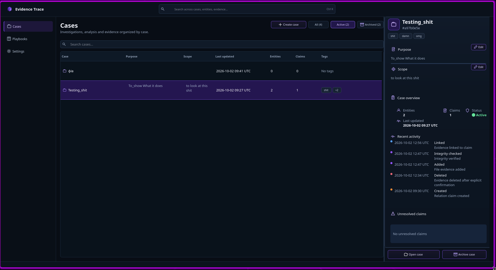
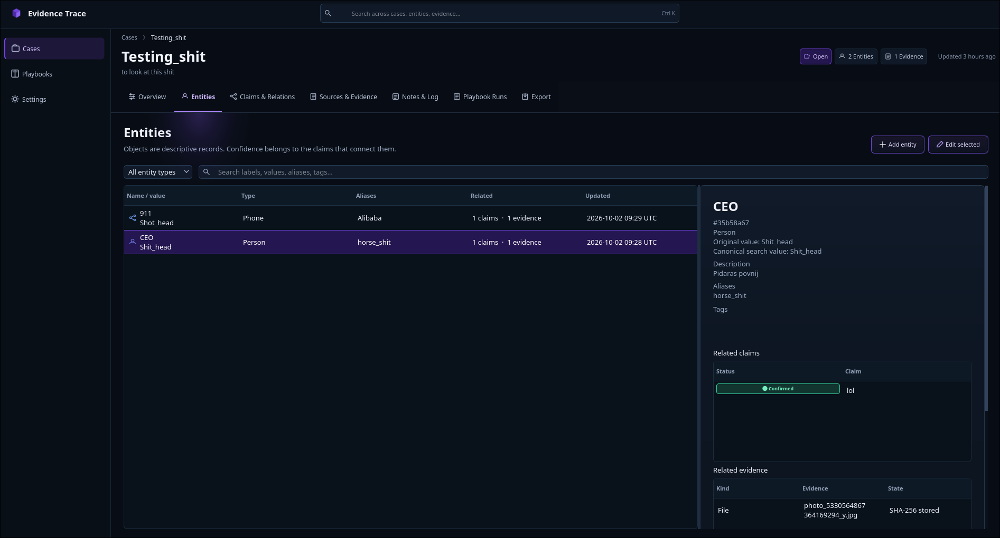
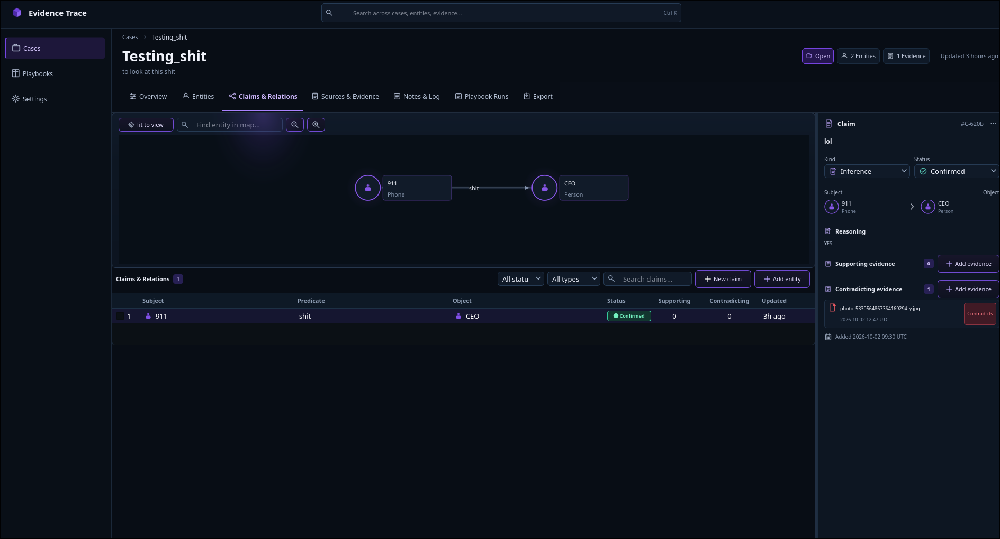

# Evidence Trace

Status: Approved

**Evidence Trace is a local-first OSINT investigation workbench.** Build a case,
preserve what you find, connect evidence to claims, and return later with a
clear record of how you reached each assessment.

It runs on Linux as a Qt 6 desktop app with a companion CLI. Case records and
preserved files are stored in a local workspace. Evidence Trace makes no
background network requests or telemetry calls; links and commands that you
choose to open or run can use the network under your account and permissions.

## Screenshots

<p align="center">
  
</p>

<p align="center">
  
  
</p>

## Follow the evidence

- **Organize a case:** track entities, sources, claims, relations, notes, and
  investigation activity together.
- **Preserve material:** import files into local storage, record quotations, or
  save a URL. Imported files are checked with SHA-256.
- **Explain assessments:** attach evidence as support, contradiction, or
  context; keep reasoning and status history with the claim.
- **See relationships:** explore recorded entity and claim relationships on a
  case map. The map visualizes records; it does not generate inferences.
- **Use your tools:** save command and link tools, launch commands in the
  integrated terminal after reviewing a confirmation, and run interactive
  shell sessions. Commands run with your operating-system permissions.
- **Resume or share a case:** use playbook runs, portable case ZIP archives
  with import validation, and an English Markdown report.

## Quick start

The supported source installation path is Linux. On Debian or Ubuntu, install
the build dependencies:

```sh
sudo apt update
sudo apt install build-essential cmake qt6-base-dev libsqlite3-dev libssl-dev libzip-dev libvterm-dev
```

Download and extract the repository, or clone it with Git. From the project
directory, run:

```sh
./install.sh
```

This builds the Release version and installs the GUI and CLI into
`~/.local/bin` by default. Add that directory to `PATH` if needed, then launch
the app:

```sh
evidence-trace-gui
```

For command-line workflows, start with:

```sh
evidence-trace --help
```

See the [build and installation guide](docs/development/build.md) for
prerequisites, CMake instructions, and install options, and the
[CLI guide](docs/user/cli.md) for commands and examples.

## Data and limitations

The database, saved tools, and copied attachments are stored in a local data
directory. The application does not encrypt this data. Export case ZIPs
regularly and verify a backup by importing it into a separate workspace.
SHA-256 detects changes to a stored file; it does not prove who created the
file or protect the database from someone with local access.

Saved links open in your system browser. Saved commands and interactive
terminal commands can access local files and the network with your user
permissions; saved commands require confirmation, while terminal commands are
entered directly by you. Evidence Trace does not sandbox or filter them.

The app does not automatically collect web pages or query external OSINT
services. It has no cloud sync, multi-user accounts, PDF report, or full-text
indexing of PDFs and images. Review the
[current behavior and limitations](docs/spec/evidence-trace-spec.md) before
using it for an investigation workflow.

## Project links

- [Product specification and data-use policy](docs/spec/evidence-trace-spec.md)
- [Architecture](docs/development/architecture.md)
- [CLI usage](docs/user/cli.md)
- [Build and installation](docs/development/build.md)
- [Test guide](docs/development/tests.md)
- [Acceptance matrix](docs/spec/acceptance.md)
- [GUI design references](docs/design/gui/README.md)
