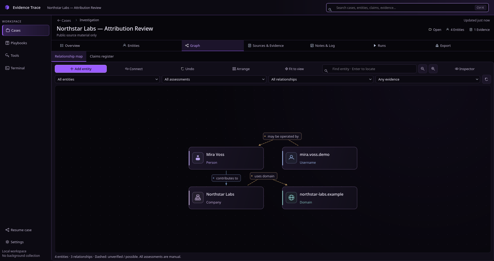
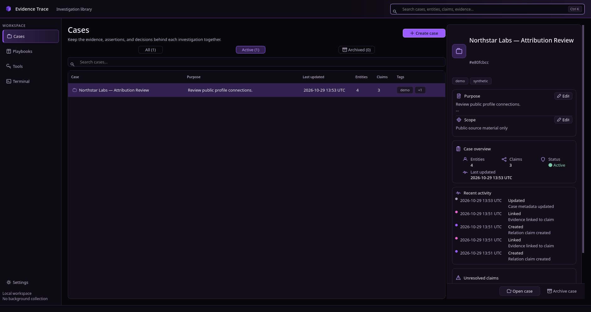
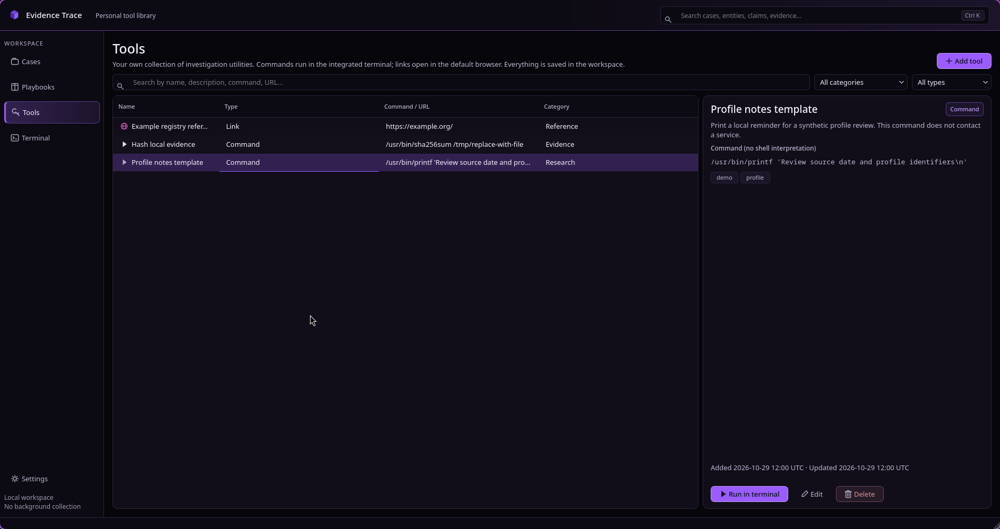
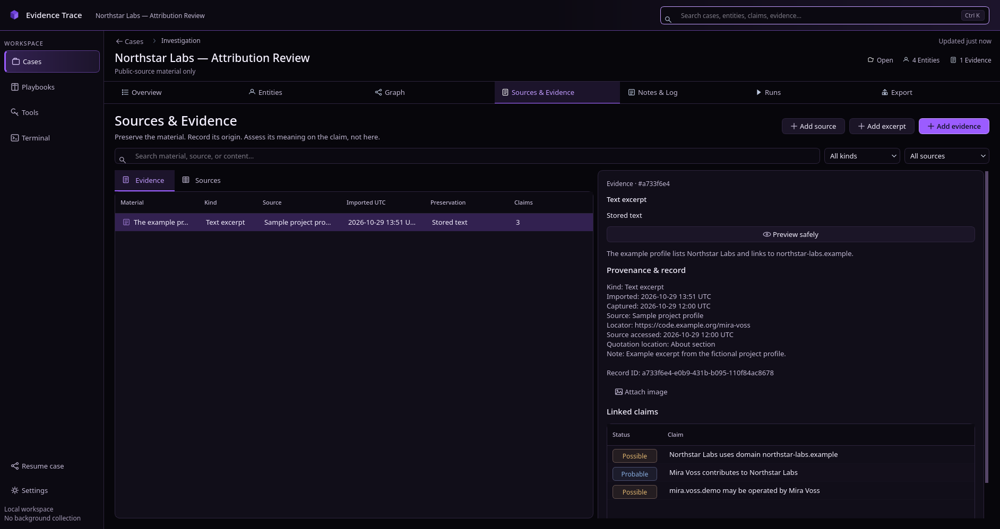

# Proposal: README visual refresh

Status: Draft

- Target: `README.md` — operation: replace.
- Proposal revision: 1.
- Reason: Owner-requested visual and editorial refresh of the project entry point: clearer navigation to existing documentation, prominent existing branding and screenshots, a compact implemented-feature overview, and readable installation steps.
- Affected documents: `README.md` only. Preserve the existing `temp.README.md` proposal unchanged.
- Discrepancies: This is a presentation-only proposal under the owner's requested README scope; no product requirements or implementation changes are proposed. The GUI behavior document's top-level page list omits Tools and Terminal, which are documented in the approved tools module and present in source. The canonical product specification currently has Draft status; its link remains the intended behavior reference, with no new approval claim.
- Verification: Read the current README, active documentation policy, product specification, module registry, GUI behavior/technical notes, tools behavior, development build guide, `CMakeLists.txt`, and `install.sh`. Inspected SHA-256 implementation, tool-launch source, and relevant integration-test assertions. Verified proposal-local links, image paths, heading anchors, Markdown fence balance, and whitespace. No application tests were run: this proposal changes presentation and wording only. No rendered preview was performed.
- Context: `docs/Humans/` is absent; human-maintained context was unavailable. No files there were created or modified.
- Approval: Ready for owner review. Exact content approval and application permission are required before replacing `README.md`.

## Proposed target content

<!-- BEGIN README.md -->
<p align="center">
  
</p>

<h1 align="center">Evidence Trace</h1>

<p align="center">
  <strong>Follow the evidence. Keep the reasoning.</strong><br />
  A local-first OSINT investigation workbench for Linux.
</p>

<p align="center">
  <strong>Linux desktop</strong> &nbsp;·&nbsp; Qt 6 + C++20 &nbsp;·&nbsp; SQLite &nbsp;·&nbsp; GUI + CLI
</p>

<p align="center">
  <a href="#quick-start">Quick start</a> &nbsp;·&nbsp;
  <a href="#inside-the-workbench">Screenshots</a> &nbsp;·&nbsp;
  <a href="#what-you-can-do">Features</a> &nbsp;·&nbsp;
  <a href="#documentation">Documentation</a>
</p>

Status: Draft

---

Build a case, preserve what you find, and connect evidence to claims. Return
months later with a clear record of **what you assessed, what supports it,
and how you got there**.

Case records and preserved files stay in a local workspace. Evidence Trace
makes no background network requests or telemetry calls. Links and commands
you choose to open or run can use the network with your account's permissions.

## Inside the workbench

### See the connections

Explore recorded entities and relationships on the investigation graph.

<p align="center">
  
</p>

<table>
  <tr>
    <th width="50%">Keep cases organized</th>
    <th width="50%">Bring your own tools</th>
  </tr>
  <tr>
    <td></td>
    <td></td>
  </tr>
</table>

<details>
<summary><strong>Look closer: preserved evidence and claim assessments</strong></summary>

<p align="center">
  
</p>

</details>

## What you can do

Implementation status: **Implemented** for the capabilities below.

| Capability | In the workbench |
| --- | --- |
| **Organize investigations** | Keep entities, sources, claims, relations, notes, and activity together in a case. |
| **Preserve material** | Import files into local storage, record quotations, and save URLs. Check stored files with SHA-256. |
| **Explain assessments** | Link supporting, contradicting, or contextual evidence to claims; retain reasoning and status history. |
| **Explore relationships** | Navigate recorded entity and claim relationships on a case map. The map visualizes records without generating inferences. |
| **Use your tools** | Save command and link tools, confirm saved commands before launch, and work in an integrated interactive terminal. |
| **Resume and share** | Follow playbook runs, export portable case ZIPs, validate imports, and produce English Markdown reports. |

## Quick start

The supported source installation path is **Linux**. The desktop app uses
Qt 6; a companion CLI supports command-line workflows.

### 1. Install dependencies

On Debian or Ubuntu:

```sh
sudo apt update
sudo apt install build-essential cmake qt6-base-dev libsqlite3-dev libssl-dev libzip-dev libvterm-dev
```

### 2. Build and install

Download and extract the repository, or clone it with Git. Run this from the
project directory:

```sh
./install.sh
```

The script builds a Release version and installs the GUI and CLI into
`~/.local/bin` by default. Add that directory to `PATH` if needed.

### 3. Open the workbench

Launch the desktop app:

```sh
evidence-trace-gui
```

Explore the CLI:

```sh
evidence-trace --help
```

See the [build and installation guide](docs/development/build.md) for
prerequisites, CMake instructions, and install options, or the
[CLI guide](docs/user/cli.md) for commands and examples.

## Your data and your tools

**Storage and backups.** The database, saved tools, and copied attachments
live in a local data directory. The application does not encrypt this data.
Export case ZIPs regularly and verify a backup by importing it into a
separate workspace.

**File integrity.** SHA-256 detects changes to a stored file. It does not prove
who created the file or protect the database from someone with local access.

**Command execution.** Saved links open in your system browser. Saved commands
require confirmation; interactive terminal commands are entered directly by
you. Both run with your operating-system permissions and can access local
files and the network. Evidence Trace does not sandbox or filter them.

### Current limitations

The app does not automatically collect web pages or query external OSINT
services. It has no cloud sync, multi-user accounts, PDF report, or full-text
indexing of PDFs and images. Review the
[current behavior and limitations](docs/spec/evidence-trace-spec.md) before
using it for an investigation workflow.

## Documentation

| Start here | Reference |
| --- | --- |
| **Install and launch** | [Build and installation](docs/development/build.md) |
| **Work from the terminal** | [CLI usage](docs/user/cli.md) |
| **Understand intended behavior** | [Product specification and data-use policy](docs/spec/evidence-trace-spec.md) |
| **Explore the codebase** | [Architecture](docs/development/architecture.md) |
| **Verify behavior** | [Test guide](docs/development/tests.md) · [Acceptance matrix](docs/spec/acceptance.md) |
| **Explore the interface design** | [GUI design references](docs/design/gui/README.md) |
<!-- END README.md -->
